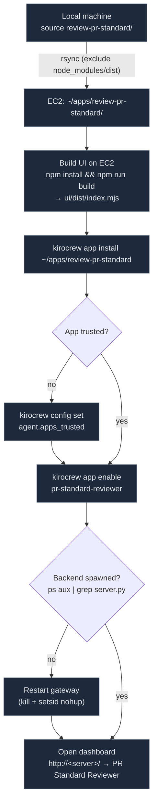
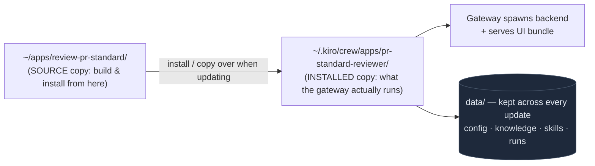

# Deployment guide — PR Standard Reviewer on Kiro Crew (EC2)

This document describes **exactly how the app is deployed** to a Kiro Crew gateway
running on EC2, and how to update it later. The goal: you can reproduce it yourself
without guessing.

## What the backend is & why it's needed

`backend/server.py` is a small HTTP server (Python stdlib) that the **gateway spawns
in the background on EC2**, reverse-proxied at `/apps/pr-standard-reviewer/api/*`. It
**holds no data in the code files** — the data lives in `data/` (config, knowledge,
skills, runs). The backend is the *processing* part, not the place where things are stored.

The backend is needed because there are things the **browser (UI) is not allowed or able to do**:

1. **Run the `gh` CLI.** The UI cannot run shell commands. The backend runs on the machine, so it can
   call `gh repo list`, `gh pr diff`, `gh pr comment`, using the host's GitHub
   credentials or the PAT from Settings.
2. **Hold the GitHub PAT secret.** The token must stay server-side and never reach the
   browser. The backend stores it in `data/config.json` and only returns the
   `hasGithubToken` flag to the UI.
3. **Persistent storage.** Knowledge Base, Skills, review history, config — written as files
   under `data/`, surviving across sessions and app updates. The UI has no disk.
4. **Build the prompt.** The backend takes the PR diff + concatenates all standards documents + skills +
   the system prompt into one large prompt and hands it to the UI.

**Key architectural point:** *running the model* does NOT go through the backend. Third-party
apps are sandboxed — the backend has no token to call back into the gateway to run the agent.
So the **UI** is the one that calls `/api/chat` (the UI has a valid session cookie). Role split:

- **Backend** = works with the system: gh CLI, read/write files, hold secrets, build the prompt.
- **UI** = orchestration + running the model + display.

Because the backend runs as a child process of the gateway, it is given the environment variables
`KIROCREW_APP_NAME`, `KIROCREW_HOME`, `KIROCREW_PROXY_SECRET` (to authenticate requests
coming from the proxy), and `KIROCREW_SANDBOX_ACTIVE`. It is **not** given a token to call
back into the gateway — which is exactly why the model has to be run by the UI.

## 0. Overall model (understand before doing)

- **The app must live on the machine running the gateway.** `kirocrew app install <path>` reads the
  path **on the gateway host** (EC2), not on your machine. The backend
  (`backend/server.py`) is spawned by the gateway **on EC2**, so `gh`, `python3`,
  and `node` all have to be present on EC2.
- **You can build the UI anywhere**, as long as the file `ui/dist/index.mjs` exists on EC2
  at install time (installing from a local path does NOT run the build automatically). The
  simplest approach: build directly on EC2.
- **Third-party apps must be "trusted"** before the gateway will run backend/agent code.
- **The backend is only spawned when the gateway STARTS.** If you enable while the gateway is already
  running, you need to **restart the gateway** so the backend comes up.

### Deploy flow diagram



### The two locations of the app on EC2 (remember when updating)



## 1. Connection details

Fill in the values for your own environment. Do not commit real instance IDs, IPs, or key names.

| Item | Value (your environment) |
|---|---|
| EC2 | `<instance-id>`, Amazon Linux 2023, region `<region>` |
| Public IP / hostname | `<server-host>` |
| SSH user | `ec2-user` |
| SSH key | `~/.ssh/<your-key>.pem` |
| Gateway | `kirocrew gateway --no-open`, port `5476`, running in background (nohup) |
| Dashboard | `http://<server-host>/` |

SSH in:

```bash
ssh -i ~/.ssh/<your-key>.pem ec2-user@<server-host>
```

Check prerequisites on EC2:

```bash
node --version      # needs >= 22.12
python3 --version
gh --version && gh auth status   # must be logged in
kirocrew --version
```

## 2. Push the source to EC2

From the local machine (exclude node_modules/dist to keep it light):

```bash
rsync -az --delete \
  --exclude node_modules --exclude .git --exclude .DS_Store --exclude __pycache__ \
  -e "ssh -i ~/.ssh/<your-key>.pem" \
  "review-pr-standard/" \
  ec2-user@<server-host>:~/apps/review-pr-standard/
```

## 3. Build the UI on EC2

```bash
ssh -i ~/.ssh/<your-key>.pem ec2-user@<server-host>
cd ~/apps/review-pr-standard/ui
npm install
npm run build        # creates ~/apps/review-pr-standard/ui/dist/index.mjs
```

## 4. Install the app

```bash
kirocrew app install ~/apps/review-pr-standard
```

The result will report that it installed but **registration was blocked by the execution policy** — this is
expected, because the third-party app is not trusted yet.

## 5. Trust the app (allow it to run code)

```bash
# view the current list
kirocrew config get agent.apps_trusted

# add the app (keeping any previously trusted apps)
kirocrew config set agent.apps_trusted '["pr-standard-reviewer"]'
```

> Or do it via the dashboard: **Settings → Security → Third-party apps**.
> `agent.apps_trusted` is the list of app names allowed to run Python/backend/agent code.
> Set `agent.apps_allow_third_party=true` if you want to allow ALL third-party apps
> (less safe).

## 6. Enable the app

```bash
kirocrew app enable pr-standard-reviewer
# -> Agents registered: 1 / Skills registered: 1
```

## 7. Restart the gateway to spawn the backend  ⚠️ important

Enabling via CLI only registers the agent/skill; **the backend process is only spawned when the gateway
starts**. Check:

```bash
ps aux | grep backend/server.py | grep -v grep   # if empty => not spawned
```

If it's missing, restart the gateway (graceful, detached from SSH so it survives after you exit):

```bash
OLDPID=$(cat ~/.kiro/crew/run/gateway-5476.pid)
kill "$OLDPID"
# wait until it fully stops
while kill -0 "$OLDPID" 2>/dev/null; do sleep 1; done
# start again, detached
setsid nohup kirocrew gateway --no-open \
  > ~/.kiro/crew/gateway-restart.log 2>&1 < /dev/null &
```

> Note: restarting the gateway causes a BRIEF interruption to every other app/channel running on
> that gateway (telegram, other apps, etc.). Pick a suitable time.

Verify the backend is alive:

```bash
ps aux | grep backend/server.py | grep -v grep
curl -s -o /dev/null -w "%{http_code}\n" http://127.0.0.1:5476/   # 200
```

## 8. Use the app

Open the dashboard `http://<server-host>/` → sidebar **PR Standard Reviewer**.
On the first visit go to the **Settings** tab (optional: enter a GitHub PAT, system prompt), then the
**Review** tab to pick a repo and run.

---

## Updating the app after changing code

When you change the source, the redeploy flow is: sync → (build if the UI changed) → update the
installed copy → restart the gateway (if the backend/manifest changed).

The gateway keeps the app in **two places**; understand this to update correctly:

| Location | Role |
|---|---|
| `~/apps/review-pr-standard/` | The source copy (where you build, and where `install` points) |
| `~/.kiro/crew/apps/pr-standard-reviewer/` | **The installed copy** that the gateway actually runs |

> A second `kirocrew app install` will report "already installed". Instead of uninstalling, the
> quick way to apply changes is to **copy over the installed copy** and then restart the gateway.

### UI changed (files in `ui/src`)

```bash
# on local
cd review-pr-standard/ui && npm run build
scp -i ~/.ssh/<your-key>.pem ui/dist/index.mjs \
  ec2-user@<server-host>:~/apps/review-pr-standard/ui/dist/index.mjs

# on EC2: update the installed copy
cp ~/apps/review-pr-standard/ui/dist/index.mjs \
   ~/.kiro/crew/apps/pr-standard-reviewer/ui/dist/index.mjs
```

Then **hard refresh the dashboard** (Cmd/Ctrl+Shift+R). The UI is an ESM module loaded into the host's
React tree, so a refresh is needed to pick up the new bundle. **No gateway restart is needed** if you
only changed the UI.

### Backend changed (`backend/server.py`)

```bash
# sync + update the installed copy
rsync -az -e "ssh -i ~/.ssh/<your-key>.pem" \
  review-pr-standard/backend/ ec2-user@<server-host>:~/apps/review-pr-standard/backend/
ssh -i ~/.ssh/<your-key>.pem ec2-user@<server-host> \
  'cp ~/apps/review-pr-standard/backend/server.py ~/.kiro/crew/apps/pr-standard-reviewer/backend/server.py'
```

Then **restart the gateway** (step 7) to respawn the backend with the new code.

### Manifest (`app.json`) or agent/skill changed

Copy over `app.json` / `agents/*.json` / `skills/**` into the installed copy, then **restart the
gateway**. Changing `permissions.api` requires a restart.

---

## The app's data (preserved across updates)

Located under `~/.kiro/crew/apps/pr-standard-reviewer/data/`:

```
data/
├── config.json      added repos, autoPostComment, systemPrompt, githubToken (PAT)
├── knowledge/        standards documents (.md) — Knowledge Base
├── skills/           skills (.md)
└── runs/             review history (.json)
```

The `data/` directory is preserved by the gateway across app updates, so the PAT, standards, skills,
and history are not lost.

---

## Common issues

| Symptom | Cause / fix |
|---|---|
| Install reports "registration blocked by execution policy" | Not trusted — do step 5. |
| `app list` shows enabled but `ps` has no backend | Backend not spawned — **restart the gateway** (step 7). |
| Reverse proxy `/apps/.../api/health` returns 403 Token required | Normal when called with curl and no cookie; the UI in the dashboard has a cookie so it works. |
| UI "Failed to load ... does not provide export X" | The bundle imports something the host doesn't have. This app is self-contained (React-only) so it shouldn't happen; if it does, check for imports outside React. |
| Review reports `t.raw is not a function` | An old version depended on `useAppApi`. The current version uses same-origin `fetch` — rebuild & redeploy the UI. |
| Review fails immediately with "HTTP 403" when calling the model | `/api/chat` needs a session cookie (the UI has one). Not an app error when used inside the dashboard. |
| gh reports "Bad credentials" | The PAT in Settings is wrong/expired, or missing the `repo` scope. Clear the PAT to fall back to the host's `gh auth`. |

## Useful commands

```bash
kirocrew app list                       # view apps & status
kirocrew config get agent.apps_trusted  # view the trusted list
tail -f ~/.kiro/crew/gateway.log        # gateway log
tail -f ~/.kiro/crew/gateway-restart.log
ps aux | grep backend/server.py | grep -v grep   # backend process
```
