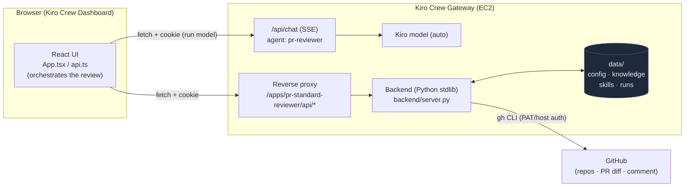
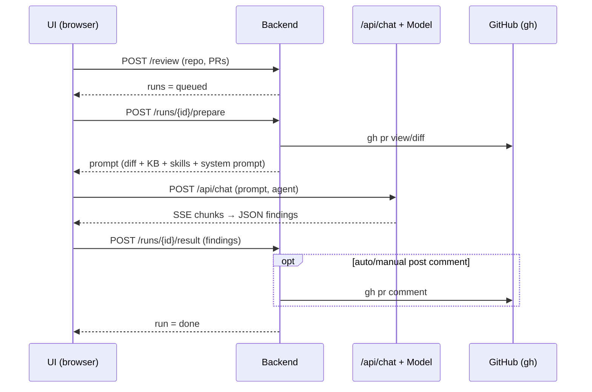

# PR Standard Reviewer

An app for **Kiro Crew** that reviews GitHub pull requests against **your own coding standards**. Pick a repo, select one or more open PRs, and the app runs a review and returns a list of findings **ordered by priority**, each one **pointing to the exact document + section** in your standards, explaining why it matters, and including guidance on how to fix it. Results can be **pushed back to the PR as a comment**.

The review relies on two things you manage directly inside the app:
- **Knowledge Base** — the standards documents to apply (WHAT to enforce).
- **Skills** — how to review (HOW to review), kept separate from the standards.

The app uses **the model already available in Kiro Crew** (no separate API key needed).

## Features

- **Add repos** from the GitHub CLI already logged in on the machine running the gateway, and select a repo to review.
- **List open PRs** for a repo, select **one or more** PRs to review at once (with filtering and select-all).
- **Visual review progress** — a progress bar based on estimated time (ETA learned from previous reviews), stage milestones (Fetch diff → Review → Parse → Post comment), a counter for the characters the model is streaming, an elapsed timer, and a cancel button. States: queued / running / done / error / cancelled.
- **Structured findings** — prioritized as must-fix / should-fix / nice-to-have (color-bordered by level), with category, file:line, **a reference to the exact document + section** of the standard, concrete fix guidance, and an overall verdict (approve / request changes / comment).
- **Standards checked** — lists ALL documents in the Knowledge Base along with their status: 🔴 has violations / ✅ pass / ➖ not applicable. Makes it clear that every standard was checked.
- **Self-managed Knowledge Base & Skills** — upload, edit, and delete standards documents and skills right in the UI (Markdown files).
- **Settings** — enter a GitHub PAT (fetches repos matching the token's account; stored server-side, hidden from the UI), add a supplemental system prompt for the LLM (with a suggested template), and enable automatic comment posting.
- **Push to GitHub** — post the review summary to the PR as a comment, either manually per review or automatically for every review.

## Tech stack

| Component | Technology |
|---|---|
| Manifest | `app.json` following the Kiro Crew App Kit standard |
| Backend | **Pure Python stdlib** (`http.server.ThreadingHTTPServer` + `subprocess` + `urllib`) — no `requirements.txt` needed, runs on the gateway's interpreter |
| GitHub integration | **GitHub CLI (`gh`)** called via `subprocess` (repos, PR list, PR diff, post comment) |
| Running the model | Gateway **`/api/chat`** (SSE stream) with the `pr-reviewer` agent — called from the UI, leveraging the `auto` model available in Kiro Crew |
| Agent | `agents/pr-reviewer.json` (forces JSON findings output) |
| Default skill | `skills/pr-review/SKILL.md` (review methodology) |
| UI | **React 18 + TypeScript**, built with **Vite** (library mode → ESM), inline styles |
| API calls (UI) | **`fetch` same-origin + dashboard session cookie** — does NOT depend on the host's `useAppApi` (gateway builds have different method shapes, which previously caused `api.raw is not a function`) |
| UI primitives | **Hand-written** in `ui/src/ui-kit.tsx` (Card, Btn, Input, SegmentedControl…) instead of `@kirocrew/app-sdk/ui` — avoids crashes from prop mismatches across host builds |
| Icons | **Hand-drawn SVG** in `ui/src/icons.tsx` — no dependency on the host's `lucide-react`, avoiding missing-export errors |
| Storage | Files under the app data dir: `data/knowledge/`, `data/skills/`, `data/runs/`, `data/config.json` |

## Architecture & flow

### Architecture diagram



Explanation: the **UI** (in the browser) orchestrates everything. It calls the **backend** through the
reverse proxy to work with `gh`/files, and calls **`/api/chat`** directly to run the
model. The **backend** does not run the model and does not call back into the gateway — it only handles the gh CLI,
`data/` storage, holding the PAT, and building the prompt.

### Why the roles are split this way

The key point: **a third-party app cannot run an agent from the backend process** (the backend is sandboxed, it only has `KIROCREW_PROXY_SECRET` to *authenticate incoming requests*, with no token to *call back into* the gateway). So the **UI acts as the orchestrator**, while the backend handles everything around it:

1. **UI → backend `/review`**: creates the runs (state `queued`).
2. **UI → backend `/runs/{id}/prepare`**: the backend builds the prompt from the *PR diff* + *Knowledge Base* + *Skills* + *the system prompt in Settings*, moves the run to `running`, and returns the prompt.
3. **UI → gateway `/api/chat`** (SSE, agent `pr-reviewer`): the **UI** runs the agent (not the backend), reads the stream to count characters (progress), and receives the JSON findings.
4. **UI → backend `/runs/{id}/result`**: saves the findings (state `done`) and (optionally) posts a comment to the PR. On error: `/runs/{id}/fail` → `error`.

The progress stages (Fetch diff / Review / Parse / Post) are tracked by the UI on the client side; the ETA is computed from `avgDurationSec` returned by the backend (the average duration of previous `done` reviews).



The backend runs as a child process of the gateway, reverse-proxied at `/apps/pr-standard-reviewer/api/*`. The UI calls the backend and `/api/chat` with same-origin `fetch` (the dashboard session cookie is attached automatically).

### Backend routes

- `GET /health`, `GET /status` (gh auth + config), `GET /repos`, `GET /prs?repo=`
- `GET /runs` (with `avgDurationSec`), `GET /runs/{id}`, `GET /knowledge`, `GET /knowledge/{name}`, `GET /skills`, `GET /skills/{name}`
- `POST /config`, `POST /repos`, `POST /review`, `POST /runs/{id}/prepare`, `POST /runs/{id}/result`, `POST /runs/{id}/fail`, `POST /runs/{id}/cancel`, `POST /runs/{id}/comment`
- `POST /knowledge`, `POST /skills`
- `DELETE /repos?fullName=`, `DELETE /knowledge/{name}`, `DELETE /skills/{name}`

`/status` and `/config` never return the PAT — they only return the `hasGithubToken` flag. The model cannot be configured through `/api/chat` in the current gateway, so the app uses `auto` (see DEPLOY.md / the notes below).

### Findings schema (JSON returned by the agent)

```json
{
  "verdict": "approve | request_changes | comment",
  "summary": "a short overall assessment",
  "standardsChecked": [
    { "doc": "doc-name.md", "status": "violations | pass | not_applicable", "note": "a short one-liner" }
  ],
  "findings": [
    {
      "id": "short-slug",
      "priority": "must_fix | should_fix | nice_to_have",
      "category": "security | performance | style | correctness | testing | docs | other",
      "file": "path/to/file",
      "line": 0,
      "title": "short title",
      "detail": "what is wrong and why it matters",
      "reference": { "doc": "doc-name.md", "section": "the rule's section/heading" },
      "fix": "step-by-step fix guidance"
    }
  ]
}
```

## Requirements (on the machine running the gateway)

- Kiro Crew gateway running; Node.js 22.12+ to build the UI.
- GitHub CLI (`gh`) logged in:

  ```bash
  gh auth login
  ```

  The app uses the host's existing GitHub credentials and **does not store a separate token**.

## Build the UI

```bash
cd ui
npm install
npm run build   # creates ui/dist/index.mjs
```

Vite externalizes React (provided by the host at runtime) and emits `ui/dist/index.mjs`. The bundle depends only on React — it does not use the host's components/hooks/icons, to avoid mismatch errors across builds.

> **Deploying to Kiro Crew on EC2:** see the detailed step-by-step guide in [DEPLOY.md](DEPLOY.md).

## Install & enable (summary)

Installing from a local folder does **not** run `onInstall`, so you must build the UI first:

```bash
kirocrew app install /absolute/path/to/review-pr-standard
```

Third-party apps are untrusted by default. Before enabling, add the app to the trusted list (to allow running backend/agent code):

```bash
# option 1: via dashboard → Settings → Security → Third-party apps
# option 2: via config (add the app name to agent.apps_trusted)
kirocrew config set agent.apps_trusted '["pr-standard-reviewer"]'
```

Then enable it:

```bash
kirocrew app enable pr-standard-reviewer
```

The backend is only **spawned when the gateway starts**. If you enable via CLI while the gateway is already running (and the Unix socket is unreachable), **restart the gateway** so the backend gets spawned:

```bash
kill $(cat ~/.kiro/crew/run/gateway-5476.pid)
sleep 3
setsid nohup kirocrew gateway --no-open > ~/.kiro/crew/gateway-restart.log 2>&1 < /dev/null &
```

The app appears in the dashboard sidebar: **PR Standard Reviewer**.

> Note: the UI is an ESM module loaded into the host's React tree. After updating `ui/dist/index.mjs`, **hard refresh** the dashboard page (or click Update in the App Store) to load the new bundle.

## Directory structure

```
review-pr-standard/
├── app.json                  Manifest
├── assets/icon.png           Store icon (512×512, opaque)
├── agents/pr-reviewer.json   Review agent (forces JSON findings output)
├── skills/pr-review/SKILL.md Default skill (how to review)
├── backend/server.py         stdlib backend (gh, storage, run orchestration)
├── ui/                       React dashboard page (source)
│   ├── src/
│   │   ├── App.tsx            Main UI + review orchestration + stages
│   │   ├── api.ts             Client calling the backend + /api/chat (fetch + parse SSE)
│   │   ├── FindingsView.tsx   Findings by priority + color borders + Standards checked
│   │   ├── ReviewProgress.tsx Progress bar + stage pills + ETA
│   │   ├── DocsManager.tsx    Manage Knowledge Base & Skills
│   │   ├── SettingsView.tsx   PAT + system prompt + auto-post
│   │   ├── ui-kit.tsx         Hand-written UI primitives (Card, Btn, SegmentedControl…)
│   │   ├── icons.tsx          Hand-drawn SVG icons
│   │   └── index.tsx          Entry point (default export + mount function)
│   └── vite.config.ts
├── ui/dist/index.mjs         Built UI bundle (ui.entry = dist/index.mjs, relative to ui/)
├── DEPLOY.md                 Guide for deploying to Kiro Crew / EC2
└── README.md
```

### What the backend does (and why it's needed)

`backend/server.py` is a stdlib HTTP server that the gateway spawns in the background and
reverse-proxies at `/apps/pr-standard-reviewer/api/*`. It handles the things the UI (browser) cannot
do:

- **Run the `gh` CLI**: list repos/PRs, fetch diffs, post comments (using the host's `gh auth`
  or the PAT in Settings).
- **Hold secrets**: stores the PAT in `data/config.json` server-side, returning only the
  `hasGithubToken` flag to the UI.
- **Storage**: Knowledge Base, Skills, review history, and config under `data/`.
- **Build the prompt**: combines the diff + all standards + skills + system prompt.

The backend does NOT run the model (third-party apps are sandboxed, with no token to call back into
the gateway) — running the model is done by the **UI** via `/api/chat`. Details in
[DEPLOY.md](DEPLOY.md) under "What the backend is & why it's needed".

## Notes & limitations

- The backend uses only the Python standard library, so no `requirements.txt` is needed.
- Running the model goes through the gateway `/api/chat` (SSE), called by the UI; the backend does not call the model directly.
- **Model**: the current gateway (0.2.0) does not accept a model specification through `/api/chat`, so the app runs on `auto` (Kiro picks the optimal model). As a result, Settings has no model selection.
- **GitHub PAT**: stored in `data/config.json` server-side, never returned to the UI. If left empty, the app uses the host's `gh auth`.
- **System prompt** in Settings is *appended* to the agent's prompt (not overriding it), inserted under the `## ADDITIONAL REVIEW INSTRUCTIONS` section.
- Standards documents, skills, and config are stored under the app data dir, so they are **preserved across app updates**.
- On a fresh first install, the app seeds a sample standards file (`example-standard.md`) so reviews are not empty.

## Deployment status (verified in practice)

Installed, trusted, and enabled on the EC2 gateway; verified end-to-end with a real repo:
- `gh` recognizes the account and lists repos and open PRs.
- Reviewing a PR: builds the prompt from a real diff → runs the `pr-reviewer` agent → returns 2 findings (`request_changes`) pointing to the exact file and standards section.
- Successfully posted a comment to the PR on GitHub.
